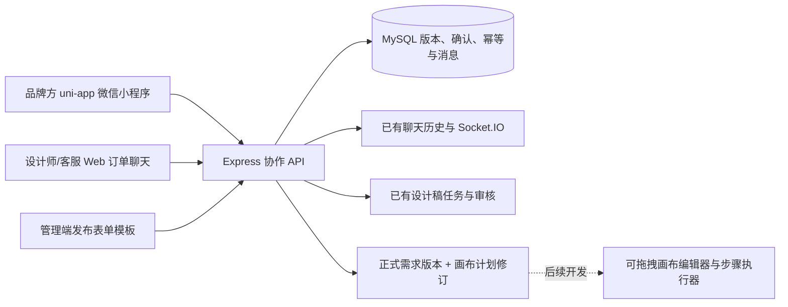

# 品牌方小程序与需求协作接入

实施日期：2026-10-09。当前实现围绕已有订单和订单聊天展开，复用 Express、MySQL、Next.js、uni-app、发布表单模板和设计稿审核模块。

## 已接通的业务流程

1. 管理员在 Web「设置 → 表单模板」发布模板。模板草稿不能直接成为填写依据。
2. 品牌方在小程序选择模板，或设计师在 Web 订单聊天面板发送表单。实例保存完整模板快照，指定订单创建品牌方填写。
3. 品牌方填写原生表单，保存草稿、提交资料。小程序支持设备本地草稿、服务器同步、跨设备版本冲突提示。提交时服务端校验必填、类型、条件字段、重复项和附件归属。
4. 从已提交表单中选择来源，生成冻结的需求候选版。界面展示完整内容、相对上一正式版本的变化、指定确认人和确认记录。
5. 按品牌方单方或双方确认策略完成确认。已分配设计师的订单，品牌方发起时使用双方确认；设计师/协作管理人员可选择品牌方单方确认。确认绑定候选版内容哈希，最后一人确认时在事务中生成唯一正式需求版本。
6. 设计师在 Web 明确承接最新正式需求，关联接单时已有的审核任务。正式提审会记录任务与图片对应的需求版本；品牌方小程序查看设计稿、按既有审核权限通过或要求修改。
7. 修改已提交资料需要发起修订。旧正式需求保留；相关待确认候选版失效，新版本重新确认并承接。

正式需求是范围与资料的确认记录。当前不会自动修改原订单报价、分组数量、付款、合同或交付规则；结构化资料与商业订单字段变化需要后续增加明确的变更流程。确认记录也不替代电子签约。

## 项目结构与职责

| 目录/文件 | 职责 |
| --- | --- |
| `packages/shared/src/collaboration.ts` | 表单实例、提交快照、候选版、正式需求、差异计算、画布契约 |
| `apps/server/src/config/collaboration-schema.ts` | 协作数据表的幂等创建 |
| `apps/server/src/services/collaboration.ts` | 权限、乐观锁、幂等、事务确认、执行关联、可靠消息、画布修订 |
| `apps/server/src/routes/collaboration.ts` | 已认证协作 API |
| `apps/web/src/components/chat/requirement-collaboration.tsx` | 订单聊天中的表单与需求协作面板 |
| `apps/uni-app/src/lib` | 登录会话、API、待发消息持久化、原生表单数据处理 |
| `apps/uni-app/src/components` | 原生表单字段、带鉴权的图片预览 |
| `apps/uni-app/src/pages` | 品牌方小程序页面 |
| `scripts/check-collaboration.ts` | 使用临时账号/订单的数据库与 HTTP 集成检查，结束时清理临时数据 |



协作对象采用独立表与 JSON 快照存储，避免被现有内存业务对象整体覆盖。每次协作写入先锁订单行，再处理表单/确认/消息序号，业务记录和聊天卡片同一事务提交。客户端传入的工作流系统卡片会被拒绝。消息广播由持久化 outbox 补发，HTTP 历史提供补拉依据；接收端按消息 ID 去重。

## 小程序页面

| 路径 | 功能 |
| --- | --- |
| `/pages/login/login` | 现有品牌方账号密码登录 |
| `/pages/index/index` | 项目列表、待填表单和待确认数量、分页、搜索 |
| `/pages/chat/chat` | 订单聊天、业务卡片、表单和需求入口 |
| `/pages/forms/templates` | 已发布模板库 |
| `/pages/forms/detail` | 填写、保存、提交、查看和修订 |
| `/pages/requirements/index` | 表单来源选择、发起确认、候选版与正式版本档案 |
| `/pages/requirements/detail` | 完整快照、变更差异、确认/退回、确认记录 |
| `/pages/reviews/index` | 设计稿审核任务列表 |
| `/pages/detail/detail` | 设计稿预览与现有权限下的逐图审核 |
| `/pages/account/index` | 当前账号、退出登录 |

当前使用已有品牌方账号密码登录；尚未接入微信 `wx.login`、手机号快捷登录或订阅消息。小程序在前台每 5 秒补拉聊天和当前需求确认，页面隐藏时停止；普通聊天先保存在按账号隔离的本地待发队列，网络恢复后使用同一个消息 ID 重试。Web 延续 Socket.IO。历史 Web 协作卡片在小程序展示摘要，旧卡片的完整操作仍在 Web；新的正式需求确认使用小程序原生页面。

## 启动和构建

在根目录执行：

```bash
pnpm install
pnpm migrate:collaboration
pnpm dev:server
```

迁移读取 `apps/server/.env` 中的 `MYSQL_URL`，只补建协作表，不创建账号、不修改原业务数据。服务启动也会检查协作表。新环境仍需先初始化原项目表及发布表单模板。`setup:database` 已增加 `--phase=collaboration` 阶段。

复制 `apps/uni-app/.env.example` 为 `.env`，设置 API 地址：

```env
VITE_API_BASE_URL=https://api.example.com/api
```

```bash
pnpm dev:mp
# 微信开发者工具导入 apps/uni-app/dist/dev/mp-weixin
pnpm build:mp
# 发布构建：apps/uni-app/dist/build/mp-weixin
pnpm --filter @design-review/uni-app dev:h5
pnpm --filter @design-review/uni-app build:h5
```

uni-app 编译器相关包已固定为同一发行版本，避免预发行版本范围解析出互不兼容的 CLI/Vite 组合；后续升级需统一升级相关包并重新构建。

微信真机/发布前，需要在 `src/manifest.json` 配置真实 AppID，使用 HTTPS API 地址，在微信后台配置 request、uploadFile、downloadFile 合法域名；如果下载经对象存储跳转，也要配置实际对象存储下载域名。开发目录保留原项目的游客 AppID 配置。H5 联调通过同一 API，服务端需允许实际 H5 来源。当前验证为 H5 浏览器交互及微信小程序编译，尚未进行微信开发者工具/真机验收。

## 接口契约

统一前缀 `/api/collaboration`，使用已有 Bearer JWT。写操作必须附带 UUID `Idempotency-Key`；请求超时后携带同一标识和相同内容重试。同一标识不同内容返回 409。普通成员只能访问本人创建/承接订单；管理员/客服沿用现有协作管理权限。

| 方法与相对路径 | 用途 |
| --- | --- |
| `GET /orders?offset=0` | 当前可访问项目，50 条一页 |
| `GET /orders/:orderId` | 一致性读取表单、候选版、正式版本、执行关联 |
| `GET /orders/:orderId/files/:assetId` | 读取显式关联此订单需求的资料文件，供双方查看 |
| `POST /orders/:orderId/forms` | 发起发布版本表单：`templateId, templateVersion` |
| `POST /orders/:orderId/forms/:formId/draft` | 小程序保存草稿：`lockVersion, answers` |
| `PATCH /orders/:orderId/forms/:formId` | Web 草稿保存兼容入口 |
| `POST /orders/:orderId/forms/:formId/submit` | 提交校验后的不可覆盖答案版本 |
| `POST /orders/:orderId/forms/:formId/return` | 修订：`lockVersion, comment` |
| `POST /orders/:orderId/candidates` | 冻结候选版：`formIds, policy, baseVersion` |
| `POST /orders/:orderId/candidates/:candidateId/decisions` | `contentHash, decision, comment`；退回必须说明原因 |
| `POST /orders/:orderId/requirements/:requirementId/execute` | 当前设计师承接最新正式需求 |
| `GET /orders/:orderId/requirements/:requirementId/ai-input` | 正式需求结构化交接数据，`executionAuthorized: false` |
| `GET /orders/:orderId/requirements/:requirementId/workflow` | 当前画布修订或 `revision: 0, plan: null` |
| `POST /orders/:orderId/requirements/:requirementId/workflow` | `revision, plan`，创建新的不可覆盖画布修订 |

附件继续使用 `/api/upload`，返回系统保护地址。表单提交校验附件归属，图片下载携带已有登录鉴权。文件资料通过订单内受控接口共享给双方，历史正式需求中引用的文件仍可追溯；设计交付原图继续遵循既有验收下载规则。单个表单多个来源出现同一字段键且答案不同时拒绝汇总，需修订或拆开确认。

## 后续可拖拽画布如何接入

画布属于设计生产工作台，建议先放在已有 Web 设计师端；品牌方继续通过小程序填写、确认和审核。当前已提供与具体编辑器无关的契约与持久化接口，尚未实现拖拽画布 UI、步骤执行器或模型调用。

```json
{
  "schemaVersion": 1,
  "requirementVersionId": "正式需求 UUID",
  "nodes": [
    {
      "id": "brief",
      "kind": "brief",
      "title": "拆解需求",
      "position": { "x": 80, "y": 160 },
      "config": {},
      "inputBindings": [{ "input": "requirement", "requirementPath": "$" }]
    },
    {
      "id": "compose",
      "kind": "compose",
      "title": "设计画面",
      "position": { "x": 420, "y": 160 },
      "config": {},
      "inputBindings": [{ "input": "brief", "sourceNodeId": "brief", "output": "items" }]
    }
  ],
  "edges": [{ "id": "edge-1", "source": "brief", "target": "compose" }]
}
```

支持 `brief / reference / generate / compose / review / delivery` 六类节点。服务端校验节点/连线 ID、引用和环形依赖；拖拽后保存 `position`，连线变化保存 `edges`，步骤参数保存 `config`。工作流修订绑定不可变需求版本；新需求需要新计划，不能悄悄替换运行中的输入。

后续执行层需单独实现 `workflow_runs / node_runs / artifacts`，包含输入快照、执行状态、错误、重试、人工审批和产物版本；计划图与一次运行分开保存。模型密钥、调用和回调只放后端执行器。对品牌需求的自动拆解先生成可编辑草案，由设计师核对后开始生产。画布使用什么前端编辑器，不影响当前需求与后端契约。

当前业务从已有订单进入协作。独立的售前会话、复杂多角色组织确认、语音/视频、后台微信推送、离线表单自动合并、AI 自动拆解与付费生图均未实现。

## 验证

```bash
pnpm check:collaboration
pnpm --filter @design-review/server exec tsc --noEmit
pnpm --filter @design-review/web exec tsc --noEmit
pnpm --filter @design-review/uni-app exec tsc --noEmit
pnpm build:server
pnpm build:web
pnpm build:mp
pnpm --filter @design-review/uni-app build:h5
```

集成检查在配置的数据库创建带随机标识的临时账号、订单、模板与任务，启动独立本地测试 API，结束时删除本轮临时数据。覆盖访问控制、草稿冲突、提交校验、隐藏字段、附件归属、请求幂等、双方并发确认、版本修订与失效、执行前置条件、画布修订/循环依赖、聊天系统消息序号与伪造拦截。不会调用 AI、支付或外部通知。`--serve` 仅用于本地 UI 联调，退出时同样清理。

本地 H5 联调使用临时数据验证了保存草稿、重复项填写、资料提交、来源选择、发起双方确认与品牌方确认记录。界面预览：[聊天](design/brand-miniapp-chat-preview.png)、[确认记录](design/brand-miniapp-confirmation-preview.png)。
