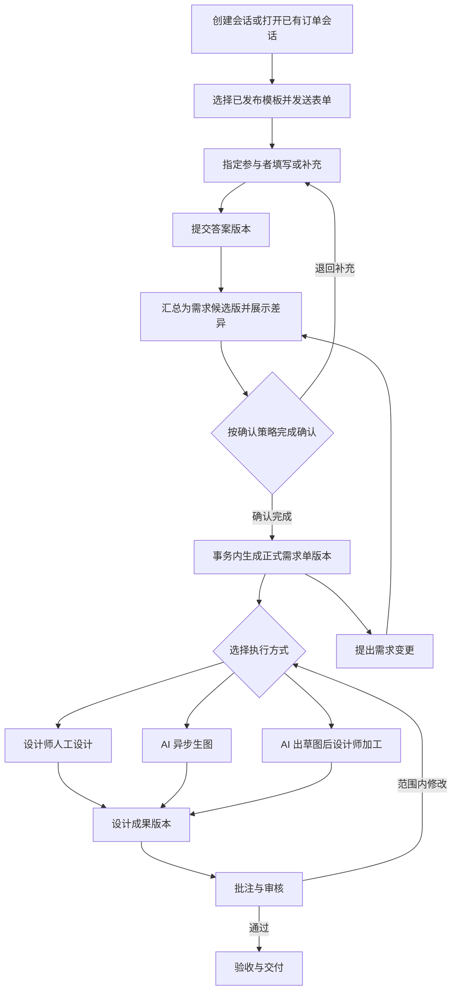
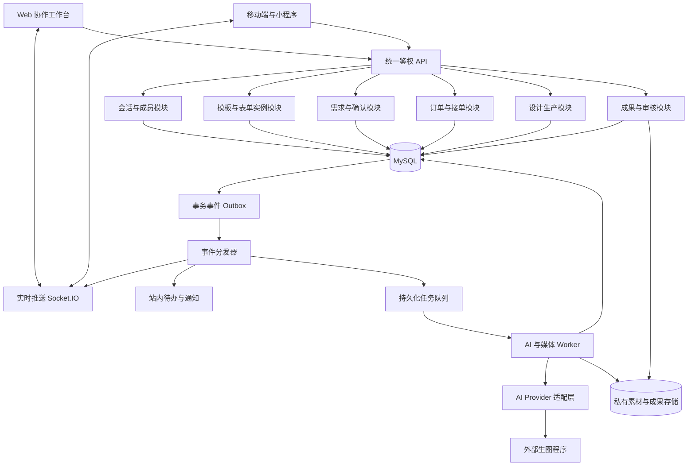
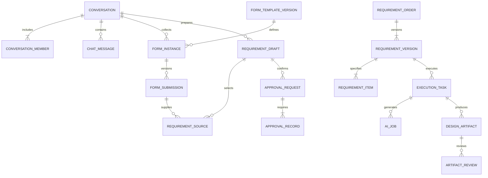

# 对话驱动的需求单与设计生产架构

状态：目标架构；已完成订单内表单、需求确认、正式版本、人工执行与品牌方 uni-app 接入。独立售前会话、拖拽画布 UI 和 AI 执行器仍为后续阶段。日期：2026-10-09。

具体已实现范围、启动方式和画布接口见 [实施说明](brand-miniapp-collaboration.md)。下文包含后续目标设计，不能视为全部已上线。

## 1. 产品定位与核心决定

将聊天升级为设计协作工作台：在同一会话内发起表单、收集资料、补充问题、确认需求、启动设计、审核和交付。正式需求单是人工设计与 AI 生图共同使用的执行依据。

主链路：



必须保持以下业务边界：

1. **会话是入口**：承载沟通和业务卡片，正式状态以业务数据库为准。
2. **表单是采集工具**：填写提交不等于确认，确认也不等于支付或验收。
3. **需求单是执行基线**：已确认内容不可覆盖，变更产生新版本。
4. **生产任务是执行记录**：人工、AI、混合任务都绑定明确的需求版本。
5. **成果与审核是独立过程**：AI 生成成功只代表得到候选图片。
6. **订单保留商业职责**：接单、报价、支付和结算继续通过现有订单流程处理。

默认采用双方确认。简单资料收集可以配置指定一方确认；AI 自助任务可配置需求方确认。正式单的确认策略由业务用途和服务端规则决定。

## 2. 当前项目基础与缺口

以下结论来自当前代码及项目文档，不代表本提案已经落地。

| 模块 | 当前基础 | 所需扩展 |
| --- | --- | --- |
| 自定义表单 | 模板字段、JSON Schema、发布历史版本、答案校验 | 会话表单实例、草稿答案、提交版本、填写权限 |
| 实时聊天 | MySQL 消息落库、序号补拉、UUID 去重、Socket.IO、浏览器发件箱 | 独立会话 ID、成员关系、业务事件与卡片引用 |
| 协作卡片 | `COZI_CHAT_CARD_V1`，需求核对、A/B 方案、协作内容及修订引用 | 业务对象引用和操作接口，完整的确认状态 |
| 订单与接单 | 品牌方批准申请后创建任务，订单金额及支付状态 | 关联需求单、绑定执行版本、需求与报价变更衔接 |
| 成果审核 | 图片提审、批注、审核与源文件交付 | 追溯需求版本、人工和 AI 成果统一入口 |
| 素材存储 | 受控上传、私有原图和预览、OSS 或本地存储 | 会话/需求/任务资源授权、资源版本、AI 输入输出关联 |
| AI 生产 | 本次检查的主链路中尚无统一生产编排 | Provider 适配、异步任务、预算、失败恢复、成果归档 |

关键结构问题：当前 `chat_conversations` 以 `order_id` 为主键，会话列表依赖已分配设计师的订单。这适合接单后的沟通，但无法完整覆盖“先聊天、再生成需求单”。目标模型应让会话独立存在，订单关联可为空。

另外，目前前端协作模板在 `service-collaboration-templates.ts` 中维护，后台表单模板另有发布版本。这两套来源应逐步统一，避免同名卡片的字段与校验不同。

## 3. 用户与交互设计

### 3.1 参与者

| 身份 | 主要动作 |
| --- | --- |
| 需求方 | 填写资料、确认文案和需求、选择方案、审核与验收 |
| 设计师 | 发起表单、检查资料、补充执行约束、确认承接范围、制作与提交成果 |
| 客服/项目协调人 | 发起会话和表单、组织确认、处理缺项、协调变更 |
| 管理员 | 维护模板、确认策略、AI 配置、审计与故障处理 |
| AI 执行器 | 按已确认版本执行任务，上报状态和成果 |

平台角色不直接等于某个会话的授权；读写和确认均检查会话成员及对象权限。客服协助填写不能代替指定确认人确认。需代办时，应配置授权关系并记录实际操作者和被代理人。

### 3.2 工作台布局

- PC：左侧会话列表，中间消息与业务卡片，右侧显示当前需求、待确认项、交付清单和生产进度。
- 移动端：聊天为主；点击卡片进入完整表单页，顶部提供需求和成果入口。
- 表单卡片显示标题、版本、指定填写人、完成度、截止时间和“填写/继续填写/查看”。
- 确认卡片显示本次需求摘要、与上版差异、确认策略、每个人的处理状态和“确认/退回补充”。
- 需求单卡片显示需求单号、当前生效版本、执行方式、交付项和“查看需求/开始设计/发起变更”。
- 生产卡片显示每项执行进度、失败原因、候选图和“查看成果/重试/转人工”。
- 审核卡片显示成果版本、批注和“通过/要求修改”。

卡片默认展示最新业务状态，同时保留“这条消息发出时”的版本快照。旧确认卡必须标为已失效；历史成果按其实际绑定的需求版本展示。

### 3.3 一次完整协作示例

1. 品牌方与设计师进入会话，设计师发送“电商主图需求”表单。
2. 品牌方填写商品、卖点、文案、参考图、尺寸和数量，可暂存后继续。
3. 设计师检查资料，发现缺少 Logo，退回并指定补充字段。
4. 品牌方补充后提交，系统保存新的答案版本。
5. 系统合并本次选中的表单版本，展示需求候选版；有冲突的尺寸、文案或数量需要人工选择。
6. 双方确认同一候选版，系统生成 `REQ-... / v1`。
7. 设计师选择人工制作，或在已授权预算内启动 AI 草图任务。
8. 图片经制作和审核后交付；新增一张图片则提出需求变更，完成确认后生成 v2。

如果尚未确定设计师，可先由需求方确认形成收集完成的需求单，用于招募或报价；人工任务启动仍要求设计师承接该明确版本。不得将单方确认显示为双方已达成一致。

## 4. 系统架构

沿用现有 Web、uni-app、Express、MySQL 和共享类型体系，采用模块化单体 API，加独立异步 Worker。第一阶段无需拆成多个微服务。



模块职责：

| 模块 | 职责 |
| --- | --- |
| 会话与成员 | 会话生命周期、成员、消息、读状态、卡片投影、历史补拉 |
| 模板与表单 | 模板发布、实例创建、字段权限、草稿保存、答案校验与提交版本 |
| 需求与确认 | 多表单汇总、标准需求转换、冲突检查、候选版、确认记录、正式版本与变更 |
| 订单与接单 | 商业订单、报价批准、设计师分配、支付和结算；引用需求版本 |
| 设计生产 | 人工/AI/混合执行任务、交付项拆分、执行计划、生产进度 |
| AI 编排 | 输入映射、能力检查、参数快照、Provider 调用、重试与预算管理 |
| 成果与审核 | 图片及源文件版本、批注、审核、终稿和交付记录 |
| 事件与待办 | 提交后的实时更新、确认提醒、执行通知、审计与可恢复任务 |

队列第一阶段可用数据库任务表和 Worker 租约实现；并发增长后接入独立队列。Redis 可承担共享广播和队列基础设施，但不保存唯一的需求、确认和成果记录。

## 5. 核心领域模型与数据库

### 5.1 关系



上图只展示核心关系；订单绑定、资源引用和事务事件见下表。

### 5.2 表与关键字段

所有新业务表统一使用稳定 ID、创建/更新时间；可编辑聚合使用 `lock_version`。多组织场景增加 `organization_id` 并在查询中校验；跨组织协作须使用显式成员关系。

| 表 | 关键字段与作用 |
| --- | --- |
| `conversations` | `id, type, organization_id, last_seq, status`，独立会话身份 |
| `conversation_members` | `conversation_id, user_id, participant_role, permissions, joined_at, left_at` |
| `conversation_order_links` | 会话与现有订单关联；MVP 每单一个主会话，预留后续一会话多单 |
| `chat_messages` | 增加 `conversation_id, message_type, entity_type, entity_id, entity_version, snapshot_json`；保留旧 body 兼容 |
| `form_templates / form_template_versions` | 复用；扩展确认默认策略、字段业务映射与权限配置 |
| `form_instances` | `conversation_id, template_id, template_version, assignee_ids, draft_json, lock_version, state, current_submission_id` |
| `form_submissions` | `instance_id, revision, answers_json, template_snapshot, submitted_by, submitted_at, content_hash`，不可变答案 |
| `requirement_drafts` | `conversation_id, requirement_order_id?, revision, normalized_json, source_hash, state, mapping_version, lock_version` |
| `requirement_sources` | `draft_id, submission_id, source_field_path, target_field_path`，追溯与冲突处理依据 |
| `approval_requests` | `draft_id, candidate_hash, policy_snapshot, state, expires_at` |
| `approval_records` | `request_id, approver_id, participant_role, decision, comment, acted_at`，指定确认人的记录 |
| `requirement_orders` | `id, requirement_no, conversation_id, current_version_id, status`，正式需求单身份 |
| `requirement_versions` | `requirement_order_id, version, draft_id, content_json, content_hash, approval_request_id, effective_at`，不可变正式版本 |
| `requirement_items` | `requirement_version_id, logical_item_id, specification_json, quantity, acceptance_json`，按交付项追踪 |
| `order_requirement_links` | `order_id, requirement_order_id, active_requirement_version_id`；激活需检查报价和承接状态 |
| `execution_tasks` | `requirement_version_id, order_id?, executor_type, assignee_id?, status, lock_version, plan_json` |
| `execution_task_items` | `task_id, requirement_item_id, status`，表达哪些交付项人工制作或 AI 制作 |
| `ai_jobs` | `task_id, item_id, input_snapshot, provider, model, provider_task_id, idempotency_key, status, attempt, lease_until, budget_reservation_id` |
| `design_artifacts` | `task_id, item_id, requirement_version_id, version, origin, asset_id, parent_artifact_id?, metadata_json` |
| `asset_bindings` | `asset_id, resource_type, resource_id, usage, asset_revision`，复用现有资源表 |
| `artifact_reviews` | 对接现有审核记录，补充 `artifact_id` 与验收基线版本 |
| `outbox_events` | `event_id, aggregate_id, aggregate_version, type, payload, dispatched_at, attempts, next_retry_at` |
| `consumer_receipts` | `consumer_name, event_id` 唯一，记录消费者处理去重 |

约束建议：

- 唯一 `(conversation_id, seq)`、`(sender_id, client_message_id)`。
- 唯一 `(form_instance_id, revision)`、`(requirement_order_id, version)`。
- 唯一 `(approval_request_id, approver_id)`；一个人在同一轮只能产生一个最终决定。
- 唯一 `requirement_versions.draft_id`，确保同一已确认候选版只生成一次正式版本。
- 唯一 AI 本地幂等键、Provider 回调事件键和消费者事件键。
- 需求当前版本指针与新版本生成在同一事务中更新，避免两个并发生效版本。
- 扫描任务按 `(status, next_run_at)` 索引；待确认按确认人和状态索引。

### 5.3 四类版本严格区分

| 版本 | 示例 | 含义 |
| --- | --- | --- |
| 模板版本 | 电商主图模板 v3 | 字段定义与校验规则 |
| 答案版本 | 表单实例第 2 次提交 | 此次实际填写的内容 |
| 需求版本 | REQ-001 / v1 | 经指定策略确认的执行基线 |
| 成果版本 | 主图 A / 第 3 稿 | 某项设计成果的迭代 |

`lock_version` 仅用于防止并发覆盖，不作为上述业务版本。新模板发布后，已发出的表单实例仍绑定原发布版本。

## 6. 表单、汇总与确认机制

### 6.1 模板分层

以现有 `FormTemplate.fields` 为基础，保留 JSON Schema 数据校验和 UI Schema 布局，新增独立业务配置：

- 字段填写方、可读方和可编辑方。
- 业务映射，例如 `productName → product.name`、`copies → deliverables[].copy`。
- 数据单位与转换规则，例如像素、数量、时间及颜色。
- 确认默认策略、允许的用途、是否可用于正式需求生成。
- 隐藏字段的保留/清空规则；参与正式确认的字段必须对确认人可见。
- AI 可接收的字段、敏感信息处理规则和素材用途。

字段权限是服务端约束，UI 隐藏或禁用仅负责交互。映射采用受限声明式规则，不执行模板中任意脚本。

### 6.2 表单实例

发起方选择已发布模板，指定填写人，创建表单实例并发送引用卡片。草稿支持自动保存；客户端带 `lock_version`，冲突返回 409 并展示差异。

第一阶段采用指定填写人/分区编辑和乐观锁，避免同时覆盖。后续有明确多人实时编辑需求时再引入协同编辑算法。

提交时按固定模板版本在服务端校验，并检查素材归属和字段权限，写入不可变 `form_submissions`。退回后重新填写产生新的提交版本，旧版本仍可追溯。

辅助表单如参考案例、讨论记录可以只作为会话资料；业务用途明确标记哪些表单进入正式需求候选版。

### 6.3 从多张表单生成同一份需求

一个会话允许多张表单，但不能简单拼接所有消息或自动采用“最后一条”。由系统规则和操作者明确选择来源提交版本，转换到统一需求结构：

```text
需求候选版
├── 基本信息：项目、商品、SKU、场景、目标人群
├── 品牌与素材：Logo、产品原图、参考图、品牌规范
├── 交付项[]：稳定项 ID、用途、尺寸、数量、格式、源文件要求
│   ├── 指定文案：必须出现、可改写、禁止出现
│   ├── 视觉要求：风格、色彩、构图、主体与背景
│   └── 验收条件：文案准确、尺寸、素材保真及其他明确标准
├── 时间与协作：交付期限、修改轮次、审核人
├── 商业约定引用：订单/报价版本、价格摘要
└── 来源：模板版本、答案版本、附件版本、字段来源及待解决问题
```

重复字段存在冲突时，需要显式选择并记录原因。只有解决必填项、冲突、失效素材和不支持的交付要求后，才能发起确认。

需求单可以引用预算和期限，但实际收款、最终订单金额与结算仍以商业订单和报价记录为准。

### 6.4 确认策略

| 策略 | 适用场景 | 通过条件 |
| --- | --- | --- |
| 指定一方确认 | 基础资料确认、AI 自助需求 | 指定用户明确确认 |
| 双方确认 | 设计师与品牌方确定交付范围 | 两个不同的指定用户均确认同一候选版 |
| 多人全部确认 | 品牌、设计师、业务负责人共同确认 | 指定名单全部通过；后续再扩展多级审批 |

提交表单默认不计作确认。如配置“提交并确认”，按钮应明确告知并记录为显式确认动作，仍须满足该流程其余确认人的条件。

确认请求固定以下内容：完整候选内容、素材版本、来源答案版本、确认人名单、确认策略及摘要哈希。哈希用于关联一致内容，不代替身份鉴权或电子签署。

确认中不得原地修改候选内容。修改时创建新候选版并关闭旧确认请求；旧确认保留为历史证据，但不能转移到新候选版。

### 6.5 最后一人确认的事务

1. 校验身份、成员状态、指定确认人和幂等键。
2. 锁定需求候选版、确认请求及正式需求单聚合，比较候选哈希和版本。
3. 写入该确认人的决定；退回则关闭本轮，不继续生成正式版本。
4. 所有人通过后，同一事务写入正式需求版本、交付项与来源，并更新当前生效版本指针。
5. 写入需求生成事件和会话系统消息；提交后由 Outbox 分发实时更新及待办。

并发点击、网络重试和提交结果不确定时返回已有确认/需求结果。不得由浏览器判断“双方都点了确认”后再单独创建需求单。

### 6.6 正式需求与执行授权

需求单的最新确认版本，与商业订单允许执行的版本分别记录。发生加价或延期变更时，新需求可以完成内容确认，但订单的 `active_requirement_version_id` 要在报价批准、承接确认及适用的支付条件满足后才切换。界面明确显示“需求已确认，待报价批准”等待办状态。

创建或启动执行任务时，服务端同时检查：需求版本有效、交付项未被取消、执行者已承接、订单条件满足、AI 能力支持、素材可用，以及实际操作者的启动权限。AI 还需明确的费用授权和可用预算；单纯确认需求不默认授权发生生图费用。

无商业订单的自助 AI 任务通过独立的额度/预算授权策略执行。可以配置自动启动，但应在流程配置和确认界面中明确告知执行方式及费用上限。

## 7. 状态机与需求变更

各对象有自己的状态，避免把所有阶段塞进订单 `status`。

| 对象 | 主要状态 |
| --- | --- |
| 表单实例 | `sent → filling → submitted`；退回进入 `returned → filling`；可取消 |
| 需求候选版 | `draft → confirming → confirmed`；可退回、撤回、过期或被新候选版替代 |
| 确认请求 | `pending → approved / rejected / cancelled / expired` |
| 需求单 | `active → closed / cancelled`；每个正式版本保持不可变 |
| 执行任务 | `pending → ready → running → waiting_review → completed`；可暂停、失败或取消 |
| AI 子任务 | `queued → submitting → running → persisting → succeeded`；可失败、待核对或取消 |
| 成果审核 | `pending → approved / revision_requested` |

范围内改稿：例如已约定的文案位置调整，保留需求版本，生成新的成果版本。

需求变更：例如交付数量、尺寸、主体、关键文案或截止时间变化，基于当前正式版本创建候选版，明确差异和受影响交付项，重新确认后产生新需求版本。

变更时遵循：

- 新候选版确认前，原正式版本继续有效。
- 受影响任务先暂停，或经明确选择继续旧版；正在执行的外部 AI 请求尽量取消，但不承诺供应商可撤销已发生费用。
- 新正式版本生效后，为受影响项创建新任务或显式重新绑定尚未开始的任务；已经开始的任务保持原版本引用。
- 旧任务结果保留，并标记对应旧需求版本；不能自动作为新版终稿交付。
- 未变更项可经人工审核复用旧成果，建立显式复用关联。
- 涉及金额和期限调整时，同步进入现有报价/订单变更审批。需求确认本身不自动完成加价和收款。
- 验收必须针对交付时选定的生效需求版本，处理全部交付项和例外批准。

## 8. 人工与 AI 统一设计生产

### 8.1 执行方式

| 方式 | 生产路径 | 审核方式 |
| --- | --- | --- |
| 人工 | 设计师领取/承接 → 设计 → 上传成果 | 复用现有审核流程 |
| AI | 能力检查 → 异步生图 → 成果归档 | 指定审核人审核候选图 |
| 混合 | AI 草图/背景/主体方案 → 设计师加工 → 最终成果 | 复用现有审核流程 |

一个需求单允许按交付项分配不同方式。第一阶段以人工和混合方式为主；纯 AI 自助流程上线前补齐无人类设计师时的审核责任人与订单处理规则。

现有接单审批已经创建 `ReviewTask`，应复用并关联对应执行任务，避免再次创建重复审核任务。新增 `execution_tasks` 记录生产职责；现有审核任务继续承载审核职责。纯 AI 模式需扩展现有必填 `designerId` 的模型，改为明确的执行主体类型和审核负责人，不能虚构一个真人设计师账号绕过限制。

### 8.2 AI 编排流水线

```text
已确认的需求版本 + 交付项 + 允许使用的素材版本
  → 统一 AI 输入结构
  → 能力及素材检查
  → 提示词/参考图/约束参数编译
  → 预算预留与幂等任务创建
  → Worker 调用 Provider
  → 回调或轮询同步
  → 结果下载并存入自有私有存储
  → 真实尺寸/文件格式/数量检查与预览处理
  → 候选成果与审核待办
```

自定义字段必须先转换成统一需求结构，再映射到不同 Provider；不把整个聊天历史直接交给生图程序。

Provider 适配层约定 `capabilities / submit / getStatus / cancel / collectResults`。不同能力缺失时显式返回不支持，提供换模型、转混合或转人工选项。

每个 AI 任务保存：需求版本、交付项、输入素材版本、提示词编译器版本、完整输入参数、Provider/模型标识、可用的随机种子、外部任务 ID、用量和费用。可追溯不代表模型升级后能完全复现相同图片。

### 8.3 电商设计的能力边界

- 需要精准中文、价格和活动日期的图，默认由模板排版或设计师完成文字层，AI 主要生成视觉素材。
- 商品外观、包装标识、Logo 和品牌色需要明确保真约束；不支持该约束的模型不能自动通过能力检查。
- 要求 PSD 分层、矢量 Logo、印刷文件或精确刀模时，安排人工/专用工具完成相关交付项。
- AI 产图后仍按文案、尺寸、数量、保真和业务验收标准检查，自动检查不替代人工最终判断。
- 交付多种尺寸时，按交付项生成或排版，不默认裁切即可满足每种构图要求。

### 8.4 异步、幂等与预算

- HTTP 请求只创建任务并返回任务 ID；长时间生图由 Worker 执行。
- Worker 使用租约、心跳和超时恢复，事件和队列可至少一次投递；状态迁移带条件更新。
- “重试同一次请求”复用幂等键；用户主动“再生成一批”创建新任务并再次预留预算。
- 外部提交超时但结果不明时进入待核对，优先通过外部任务 ID 或客户端引用查询。供应商不支持幂等/查询时，转人工核对，不能盲目再次提交并承诺不重复扣费。
- 回调验签、校验 Provider 与本地任务映射、去重；乱序回调不能把成功状态改回运行中。
- 供应商生成完成但素材尚未入库时保持 `persisting`；资源归档可独立重试。
- 仅在结果持久化后写入成果并标记成功。保存每个交付项的成功/失败，允许部分重试。
- 预算原子预留，结算按实际用量核对并释放余额；设置单任务、会话和日用量上限。
- 使用并发限制、重试退避和熔断，监测队列等待、失败率及滞留任务。

## 9. API 与事件契约

保留现有 `/api` 前缀；以下为新接口提案，不表示已存在。

| API | 用途 |
| --- | --- |
| `POST /conversations` | 创建订单前会话或关联已有订单 |
| `GET /conversations/:id/messages?afterSeq=N` | 拉取混合消息与业务卡片 |
| `POST /conversations/:id/form-instances` | 发起固定模板版本的表单 |
| `PATCH /form-instances/:id/draft` | 保存答案草稿，带 `lockVersion` |
| `POST /form-instances/:id/submit` | 校验并创建答案版本 |
| `POST /form-instances/:id/return` | 退回补充，记录字段路径与原因 |
| `POST /conversations/:id/requirement-drafts` | 选择来源版本并生成标准需求候选版 |
| `PATCH /requirement-drafts/:id` | 编辑尚未冻结的候选版，带并发版本 |
| `POST /requirement-drafts/:id/request-confirmation` | 冻结内容并发起确认 |
| `POST /approval-requests/:id/decisions` | 确认/退回；最后确认自动生成正式需求版本 |
| `GET /requirements/:id/versions/:version` | 获取正式需求和确认追溯 |
| `POST /requirements/:id/change-requests` | 从生效版本创建变更候选版 |
| `POST /requirement-versions/:id/execution-tasks` | 创建人工、AI 或混合任务 |
| `POST /execution-tasks/:id/ai-jobs` | 在授权范围和预算内启动 AI 子任务 |
| `POST /execution-tasks/:id/artifacts` | 登记人工成果或加工成果 |
| `POST /ai-jobs/:id/retry` | 重试可安全恢复的任务 |
| `POST /ai-jobs/:id/cancel` | 申请取消并追踪实际结果 |
| `POST /ai/providers/:provider/callback` | Provider 回调，使用独立签名鉴权 |

新增写操作使用 `Idempotency-Key`；保存请求摘要，键复用但内容不同则返回 409。原有聊天继续兼容 `clientMessageId`。

实时业务事件统一使用：

```json
{
  "eventId": "evt_example",
  "type": "requirement.version.created",
  "conversationId": "conv_example",
  "aggregateId": "req_example",
  "aggregateVersion": 1,
  "occurredAt": "2026-10-09T02:00:00.000Z",
  "data": { "requirementVersionId": "reqv_example" }
}
```

建议事件包括 `form.instance.created`、`form.submitted`、`approval.requested`、`approval.decided`、`requirement.version.created`、`execution.started`、`ai.job.updated`、`artifact.created` 和 `review.completed`。

消息时间线仍以会话 `seq` 为补拉游标；业务事件用于提示刷新对应对象。客户端按 `eventId` 去重，并忽略聚合旧版本更新。断线恢复后补拉时间线，再读取当前需求、待确认和任务快照。

## 10. 一致性、权限与运维

### 10.1 提交与通知

业务修改、系统消息、Outbox 事件在同一 MySQL 事务内写入。分发器提交后投递，失败可重试。消息广播、站内通知和外部程序调用都不是事务内的网络依赖。

消费者按事件 ID 去重。普通聊天可先沿用当前机制；需求生成、确认和任务启动等关键动作应使用 Outbox，避免“需求已生成但没有提醒”或“只有卡片没有业务对象”。

### 10.2 权限与素材

- 所有入口校验会话成员和目标对象归属；确认额外校验固定名单和候选版本。
- AI 执行器只能访问该任务被允许使用的素材；密钥与供应商凭证留在服务端。
- 附件绑定资源 ID 和内容版本，不把临时签名 URL 当作永久需求记录。
- 传给供应商的原图使用受限时效访问或服务端传输，输入资料按用途筛选。
- 外部输出下载由 Worker 进行，限制地址、重定向、大小和文件类型；统一转存，避免依赖供应商临时链接。
- 成员移除、设计师更换和账号停用应更新有效权限并断开/移除实时订阅；历史审计仍保留。
- 当前代码存在客服/管理员的全局会话读取与角色广播；目标按实际协作授权收窄。如业务保留全局监管，应单独授权、标明用途并审计。
- 待办必须持久化；用户离线时仍能在下次登录看到待确认和失败任务。

### 10.3 观测与恢复

围绕会话、需求版本、生产任务和外部请求建立关联 ID。记录确认耗时、需求变更次数、任务队列时延、Provider 成功率、实际费用、回调延迟和素材归档失败。

定时扫描超时确认、过期 Worker 租约、待核对的外部提交、未分发事件和未归档成果。生产环境以 MySQL 和私有对象存储为事实源，不允许正式确认流程静默退回内存。

## 11. 与当前代码的接入建议

建议逐步增加以下领域文件，具体拆分在实现时结合当前代码调整：

```text
packages/shared/src/
  conversation.ts
  form-instance.ts
  requirement.ts
  approval.ts
  execution.ts
  ai-contract.ts

apps/server/src/services/
  conversations.ts
  form-instances.ts
  requirement-drafts.ts
  requirement-confirmation.ts
  execution-tasks.ts
  outbox.ts
  ai/providers/

apps/server/src/workers/
  outbox-dispatcher.ts
  ai-job-worker.ts
  asset-import-worker.ts

apps/web/src/components/chat/
  form-instance-card.tsx
  requirement-confirmation-card.tsx
  requirement-order-card.tsx
  execution-task-card.tsx
```

现有文件处理原则：

- `form-config.ts` 与后台表单配置器继续复用；扩展业务元数据，不复制第二套字段模型。
- `chat-cards.ts` 保留旧消息解析；新增带协议版本和业务对象引用的卡片类型。
- `service-card-composer.tsx` 逐步从本地标签/字符串数组改为渲染发布模板和操作表单实例。
- `chat.ts` 与 `chat-schema.ts` 从 `orderId` 会话扩展到 `conversationId`；保留旧 API 转换入口。
- 接单批准及已有审核任务通过显式关联接入生产任务，不重新生成已有商业订单。
- 老订单无需求版本时显示“历史需求”，不伪造确认记录；可通过补充确认建立首个正式版本。

迁移顺序：新增会话及成员表 → 按已有订单回填稳定会话 ID 和现有参与方 → 消息增加并回填 `conversation_id` → 旧接口适配新会话服务 → 校验消息数量/顺序/权限 → 切换新入口。迁移期间明确一份权威写入路径，避免两套消息并行写入造成重复。

## 12. 实施阶段与验收

| 阶段 | 交付范围 | 验收依据 |
| --- | --- | --- |
| P1：需求闭环 | 复用订单聊天，模板实例、草稿、提交、双方确认、正式需求版本与来源 | 能从会话生成可追溯需求；重复/并发确认只生成一次；修改不沿用旧确认 |
| P2：协作与生产 | 独立会话、订单前沟通、人工任务绑定、成果版本、需求变更和审核关联 | 人工每份成果可追溯需求版本；新需求未确认前不覆盖旧版；商业订单不重复创建 |
| P3：AI 辅助 | 单一 Provider、异步 Worker、预算预留、候选图归档、人工审核 | 外部超时可核对；部分失败可恢复；不会将生成成功显示为验收完成 |
| P4：扩展 | 多 Provider、纯 AI 自助、交付项混合执行、多方确认、多实例共享广播 | 能力差异可处理；离线/多端状态一致；费用及资源授权可审计 |

P1 可以继续使用已有订单作为会话入口，但共享模型先使用独立会话 ID，为 P2 留出迁移空间。正式流程要求数据库可用，保留当前纯表单编辑演示模式的同时明确其不支持生产确认。

关键验证场景：

1. 两人同时确认、重复请求、确认成功但客户端超时，只生成一个需求版本。
2. 一人已确认后内容被修订，旧确认请求不能让新版本通过。
3. 同一会话多表单有冲突时禁止发起确认，来源版本和解决结果可追溯。
4. 模板升级、归档和成员变更不会悄悄改变已发出表单或历史确认内容。
5. 草稿并发保存返回可处理的版本冲突，服务端阻止修改无权限字段。
6. 变更仅影响对应交付项，旧结果保留且不能自动作为新版终稿。
7. AI 提交结果未知、重复回调、Worker 重启和素材归档失败均可恢复。
8. 同一预算并发启动任务时不会超额预留；主动再生成有独立费用记录。
9. 纯 AI 任务仍有明确审核负责人和验收条件。
10. 原有消息历史、接单、支付、审核与交付流程继续可用。

建议优先落地表单实例、确认事务和正式需求版本；它们是人工与 AI 两条生产路径共用的基础。
